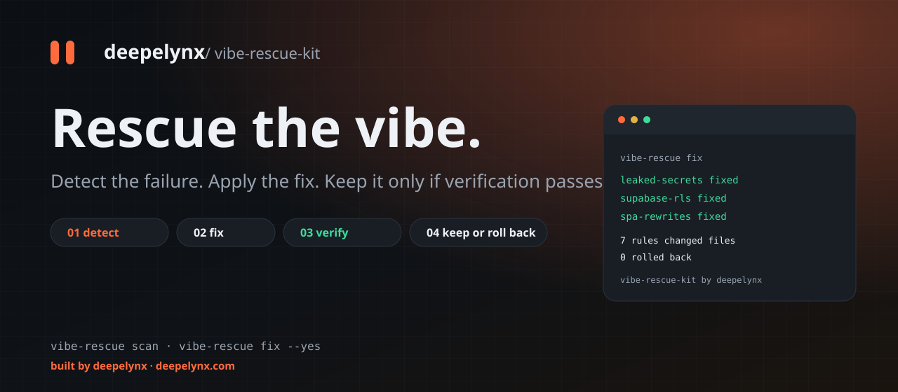
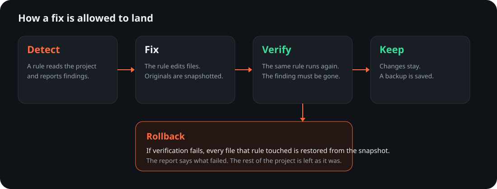
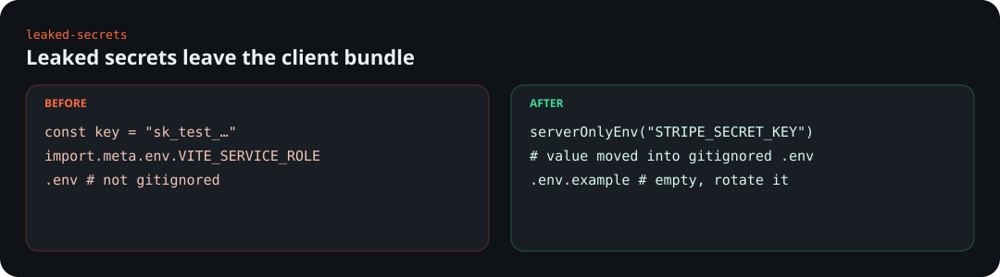
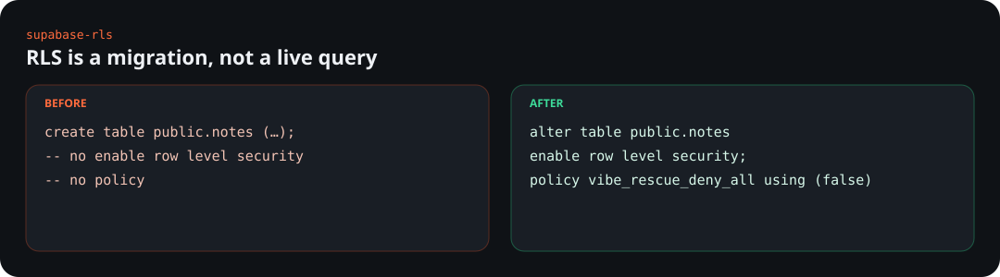
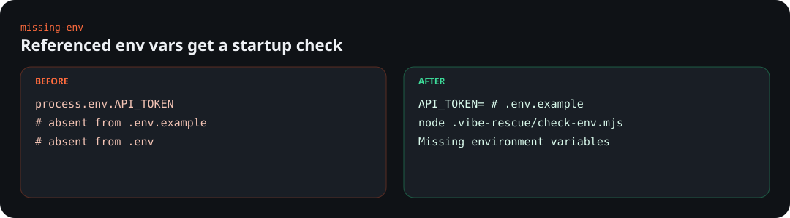
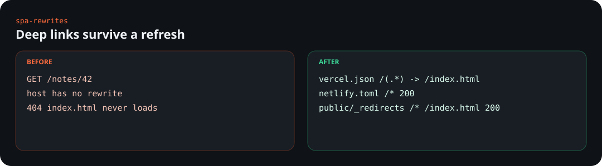
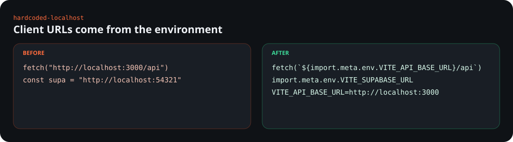
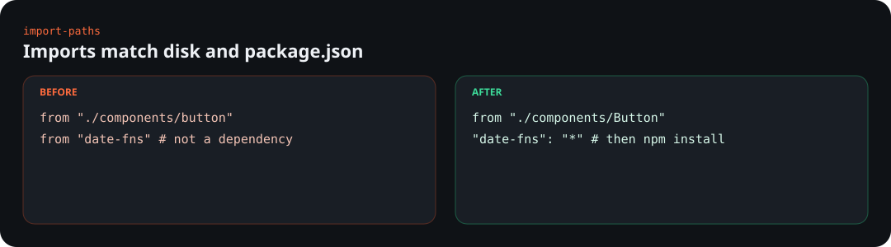
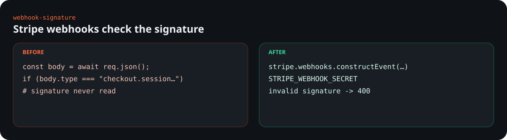

<p align="center">
  
</p>

<p align="center">
  <a href="LICENSE"></a>
  <a href="package.json"></a>
  <a href="https://github.com/deepelynxsystems/vibe-rescue-kit/actions/workflows/ci.yml"></a>
  <a href="#built-in-rules"></a>
</p>

**vibe-rescue-kit** fixes the failures that show up after a weekend with Lovable, Bolt, Cursor, Replit, or v0. It is a local CLI for Vite, React, and Next.js projects that also use Supabase. Each problem is a rule with three parts: **detect**, **fix**, and **verify**. A fix is kept only when verification passes. Otherwise the files are restored and the report says why.

```bash
npx vibe-rescue scan
npx vibe-rescue fix --dry-run
npx vibe-rescue fix --yes
```

This repository is the source. It is not published to npm from here. Until it is, clone it and run the local build (see [Develop](#develop)).

Built by [deepelynx](https://deepelynx.com).

## See it run

These GIFs are recordings of the built CLI. Scan and fix run on `examples/broken-spa`. Watch starts from `fixtures/hardcoded-localhost`, then a new client file appears with a hardcoded secret and the watcher fixes it.

<p align="center">
  
</p>

<p align="center">
  
</p>

<p align="center">
  
</p>

MP4 copies of the same recordings live in [`docs/assets/`](docs/assets/). Plain transcripts for every fixture are in [`docs/assets/terminal/`](docs/assets/terminal/).

## What a fix is allowed to do



Every auto-fix is reversible:

- Before a rule writes, the engine snapshots the original bytes.
- `--dry-run` applies the fix, runs verification, prints the diff, and restores the files.
- Without `--yes` (or `--auto`) a terminal prompts. A non-interactive shell refuses to write and exits 2.
- Verification re-runs the rule. If the finding is still there, that rule's writes are rolled back.
- Kept fixes store originals in `.vibe-rescue/backups/<timestamp>/`. That directory is gitignored. It can contain secrets.
- Reports redact secret-shaped strings. The `.env` file on disk still has the real value.

Exit codes: `0` clean or every fix verified, `1` findings remain or a fix was rolled back, `2` usage error or confirmation required.

## Install

After the package is published:

```bash
npm install -D vibe-rescue-kit
npx vibe-rescue scan
npx vibe-rescue fix --yes
```

From a clone of this repo:

```bash
npm ci
npm run build
node dist/cli.js scan /path/to/your-app
```

Node.js 20 or newer.

## Commands

| Command | What it does |
| --- | --- |
| `vibe-rescue scan [path]` | Report problems. Exits 1 when any finding exists. |
| `vibe-rescue fix [path]` | Fix, verify, roll back failures. |
| `vibe-rescue watch [path]` | Re-run when files change. `--yes` applies fixes. |
| `vibe-rescue new-rule <id>` | Scaffold `.vibe-rescue/rules/<id>.yaml` (or `--type module`). |
| `vibe-rescue eject <id>` | Copy a built-in rule into the project so you can edit its detector. |
| `vibe-rescue rules` | List the built-in rules. |
| `vibe-rescue install-hook` | Install a git pre-commit hook. |
| `vibe-rescue install-action` | Add `.github/workflows/vibe-rescue.yml`. |

Flags worth knowing:

| Flag | Effect |
| --- | --- |
| `--yes`, `--auto` | Apply without prompting. |
| `--dry-run` | Show the verified diff, then restore the tree. |
| `--rule <id>` | Run one rule. |
| `--json` | JSON on stdout. The credit line goes to stderr. |
| `--staged` | Only findings whose file is staged in git. |
| `--hook` | After a kept fix, `git add` the changed files that are not ignored. |

`vibe-rescue fix --yes --hook --staged` is what the pre-commit hook runs. It fixes staged files, verifies them, and stages the kept edits. `.env` stays unstaged because it is gitignored.

## Demo script

```bash
npm run build
bash scripts/demo.sh
```

The script copies `examples/broken-spa` to a temp directory, then runs `scan`, `fix --dry-run`, `fix --yes`, and `scan` again. The example in git stays broken so the demo can be repeated.

## Built-in rules

### leaked-secrets

Service-role JWTs, `sk_live` / `sk_test` / `rk_` keys, `sb_secret_` keys, AWS access key ids, GitHub `ghp_` tokens, private-key blocks, and client reads of env names shaped like secrets. Also an `.env` that is not gitignored, and a real secret committed in `.env.example`. Anon keys and `pk_` publishable keys are left in client code. Files under `api/`, `server/`, and `*.server.*` are treated as server code.

The fix moves the value into gitignored `.env`, writes an empty key in `.env.example`, and replaces the client literal with `serverOnlyEnv("NAME")`, which throws in the browser. **Rotate the key.** The tool does not call the provider, and it does not rewrite git history. If git still tracks `.env`, run `git rm --cached .env`.



### supabase-rls

`CREATE TABLE` in `supabase/migrations`, `migrations`, or `db/migrations` with RLS off, RLS disabled, or RLS on and no policy. The state is tracked across migration files in filename order. A comment that mentions `enable row level security` does not count.

The fix writes a new migration that enables RLS and adds `vibe_rescue_deny_all` for `anon` and `authenticated` with `USING (false)`. **No database connection is opened.**



### missing-env

`process.env.NAME` and `import.meta.env.NAME` (and the bracket form) when `NAME` is missing from `.env.example` or from the local env files. `NODE_ENV`, Vite's `MODE` / `DEV` / `PROD` / `SSR` / `BASE_URL`, and a short built-in skip list are ignored.

The fix adds the keys (empty) to `.env.example` and `.env`, writes `.vibe-rescue/check-env.mjs`, and wires `predev` / `prestart` when those scripts exist. Empty values still fail the startup check, so `npm run dev` refuses to boot until you fill them in. The rule is satisfied once the names exist in the files.



### spa-rewrites

A Vite app with `index.html` and a client router (`react-router-dom`, `wouter`, TanStack Router, and the usual suspects) and no host fallback. Next.js projects are skipped.

The fix merges a rewrite into `vercel.json` (existing keys such as `buildCommand` stay), appends a Netlify `[[redirects]]` block, and writes `public/_redirects`. If an `api/` directory exists, the Vercel source excludes `api/`.



### hardcoded-localhost

`http://localhost` and `http://127.0.0.1` string literals in client source. Port `54321` and `54322` become `VITE_SUPABASE_URL` or `NEXT_PUBLIC_SUPABASE_URL`. Other ports become `VITE_API_BASE_URL` or `NEXT_PUBLIC_API_BASE_URL`. Paths are kept (`/api/items`). Server files are not rewritten. The previous origin is written to `.env` and `.env.example` as the local default.



### import-paths

Relative imports whose casing does not match the file on disk, and bare imports whose package is missing from `package.json`. Node built-ins, `node:` imports, and `tsconfig` / `jsconfig` path aliases (plus `@/`) are left alone. Ambiguous case matches are reported and not rewritten.

The casing is corrected in the specifier. Missing packages are added as `"*"`. **The package manager is not run.** Run `npm install` afterwards.



### webhook-signature

A file whose name or route mentions a webhook, mentions Stripe, and never calls `constructEvent`. A Stripe helper that is not a webhook is ignored.

The fix handles two shapes. App Router `await req.json()` is replaced with `request.text()` plus `constructEvent`. `const event = req.body` (Express or Next Pages) is replaced with a raw-body check; Pages handlers also get `bodyParser: false`. `STRIPE_WEBHOOK_SECRET` is added to `.env.example`. The tool does not call Stripe.



## Out of scope

- Live databases. RLS work is a migration file. Nothing connects to Postgres or Supabase.
- Email deliverability, DNS, SPF, DKIM, and inbound mail.
- Production deletes, data migrations that drop rows, and destructive remote commands.
- Rotating a leaked key at the provider, or purging it from git history.
- Running the package manager, deploying, or publishing.

## Write a rule

A rule is a YAML file or a JavaScript/TypeScript module. Project rules live in `.vibe-rescue/rules/`. Built-ins are TypeScript strategies. Their default problem definition is the `detect` block. Drop a YAML file with the same `id` and only a `detect` section to change what counts as the problem. Add a `fix` block and the file replaces the built-in strategy entirely.

```bash
vibe-rescue new-rule no-foo --title "No foo left in src"
vibe-rescue eject leaked-secrets
```

`eject` writes `.vibe-rescue/rules/leaked-secrets.yaml` with the current detector. Arrays replace the built-in list. `appendSecretPatterns` on `leaked-secrets` adds patterns without dropping the defaults.

Declarative YAML:

```yaml
id: no-foo
title: No foo left in src
description: foo should be bar.
severity: warning
detect:
  globs:
    - "src/**/*.{ts,tsx,js,jsx}"
  pattern: "\\bfoo\\b"
  message: "Found foo in $file:$line."
fix:
  type: replace
  pattern: "\\bfoo\\b"
  replacement: "bar"
verify:
  type: rescan
```

`verify.type` may be `rescan` (default) or `command`. A command runs in the project directory and must exit 0.

A module default-exports `detect`, `fix`, and `verify`. Loaders accept `.mjs`, `.js`, `.cjs`, `.ts`, and `.mts` via [jiti](https://github.com/unjs/jiti). Use `defineRule` from `vibe-rescue-kit` if you want the type.

```js
export default {
  id: "no-foo",
  title: "No foo left in src",
  description: "foo should be bar.",
  severity: "warning",
  async detect(ctx) {
    const findings = [];
    for (const file of await ctx.glob(["src/**/*.ts"])) {
      const text = await ctx.read(file);
      if (!text.includes("foo")) continue;
      findings.push({
        fingerprint: `no-foo:${file}`,
        ruleId: "no-foo",
        severity: "warning",
        message: `Found foo in ${file}.`,
        file,
      });
    }
    return findings;
  },
  async fix(ctx, findings) {
    for (const finding of findings) {
      const text = await ctx.read(finding.file);
      await ctx.write(finding.file, text.replaceAll("foo", "bar"));
    }
    return { notes: [] };
  },
  async verify(ctx, findings) {
    const again = await this.detect(ctx);
    const ids = new Set(again.map((item) => item.fingerprint));
    const left = findings.filter((item) => ids.has(item.fingerprint));
    return left.length === 0
      ? { ok: true, message: "Verification passed." }
      : { ok: false, message: "Verification failed." };
  },
};
```

`ctx` during `detect` can `read`, `readMaybe`, `exists`, and `glob`. `write` throws during detect. During `fix`, `write` records the original file for rollback. Paths that escape the project are rejected.

Disable a rule or add ignore globs in `.vibe-rescue/config.yaml`:

```yaml
disable:
  - spa-rewrites
ignore:
  - "vendor/**"
```

## Git hook and GitHub Action

```bash
vibe-rescue install-hook
vibe-rescue install-action --mode scan
```

The hook is `.git/hooks/pre-commit`, or `.husky/pre-commit` when `.husky/` exists. It runs `vibe-rescue fix --yes --hook --staged`.

Use the action from this repository:

```yaml
- uses: actions/checkout@v4
- uses: deepelynxsystems/vibe-rescue-kit@v1
  with:
    mode: scan   # or fix
```

`mode: fix` passes `--yes`. The action builds `dist/` when the checkout does not already contain it. Inputs are `mode`, `rule`, and `working-directory`.

## Develop

```bash
npm ci
npm test
npm run build
node dist/cli.js rules
```

Fixtures under `fixtures/` are intentionally broken projects, one per rule. `examples/broken-spa` combines all seven. Tests copy them to a temp directory, scan, fix, and scan again. `npm test` is the bar for a change.

Every CLI process prints `vibe-rescue-kit by deepelynx` as it exits.

## License

[MIT](LICENSE) © deepelynx

Built by [deepelynx](https://deepelynx.com).
